# Módulo 0: Ambiente de estudo com RHEL 8 no Hyper-V

Neste módulo você monta uma máquina virtual com o Red Hat Enterprise Linux 8.10, para praticar o restante do curso sem risco de quebrar nada.

Ao final você terá:

- uma VM `RHEL8-Lab` rodando no Hyper-V;
- o RHEL 8.10 instalado, registrado e atualizado;
- um ponto de verificação para voltar ao estado limpo quando precisar.

**Tempo estimado:** 1h30 (a maior parte é download e instalação).

## Sumário

- [Fase 0: Preparação](#fase-0-preparação)
- [Fase 1: Criar a VM](#fase-1-criar-a-vm)
- [Fase 2: Ajustes antes de ligar](#fase-2-ajustes-antes-de-ligar)
- [Fase 3: Instalar o RHEL](#fase-3-instalar-o-rhel)
- [Fase 4: Primeiro boot e registro](#fase-4-primeiro-boot-e-registro)
- [Problemas comuns](#problemas-comuns)

> [!NOTE]
> **Por que VM e não container?** Um container compartilha o kernel do host e não tem `systemd`, boot nem serviços próprios. A VM é um computador completo, e é nela que o sistema se comporta como um servidor. Além disso, a Red Hat não publica uma imagem Docker "RHEL 8": a imagem base de container é a UBI, que dá acesso só a parte dos repositórios.

> [!NOTE]
> **Sobre as capturas de tela.** Alguns dados foram ocultados por privacidade: nome do computador, usuário do Windows, endereços de rede e identificadores de hardware. As áreas em branco ou cobertas não indicam erro. Na sua tela, esses campos aparecem preenchidos com os valores do seu ambiente.

---

## Fase 0: Preparação

### 0.1 Verificar os pré-requisitos da máquina

| Requisito | Mínimo | Recomendado |
|---|---|---|
| Windows | 10/11 **Pro** ou **Enterprise** | |
| RAM | 8 GB | 16 GB |
| Disco livre | 60 GB | 80 GB |

A edição Home do Windows não tem Hyper-V.

Confira se o hipervisor está ativo. No PowerShell:

```powershell
(Get-CimInstance Win32_ComputerSystem).HypervisorPresent
```

O resultado precisa ser `True`.

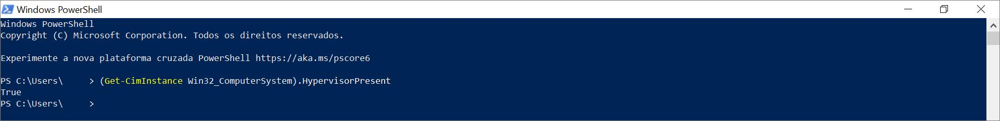

Se retornar `False`, abra o PowerShell **como administrador**, execute o comando abaixo e reinicie o computador:

```powershell
Enable-WindowsOptionalFeature -Online -FeatureName Microsoft-Hyper-V -All
```

### 0.2 Criar a conta e garantir o acesso de desenvolvedor

1. Acesse <https://developers.redhat.com> e crie uma conta (ou entre com a que você já tem).
2. Aceite os termos do **Red Hat Developer Program**.

Isso ativa a *Red Hat Developer Subscription for Individuals*: gratuita, para uso pessoal e estudo, com o RHEL completo.

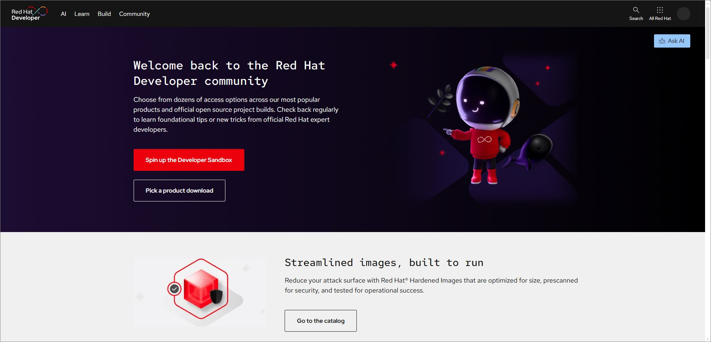

### 0.3 Baixar a ISO

1. Acesse <https://developers.redhat.com/products/rhel/download>.
2. Escolha **RHEL 8.10**, arquitetura **x86_64**, opção **DVD ISO** (cerca de 13 GB).
3. Salve na pasta `Downloads`.
4. Deixe a página aberta: você vai usar o checksum SHA-256 exibido nela.

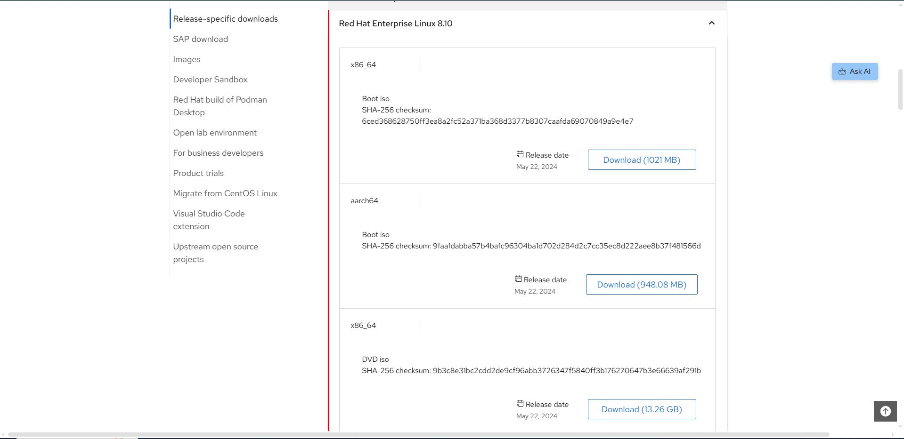

| Opção | Tamanho | Quando usar |
|---|---|---|
| **DVD ISO** | ~13 GB | Instalação completa e offline. É a usada neste curso. |
| Boot ISO | ~1 GB | Baixa os pacotes durante a instalação; exige rede e registro no instalador. |

### 0.4 Conferir o checksum

Calcule o SHA-256 do arquivo baixado (leva de 1 a 2 minutos):

```powershell
Get-FileHash "$env:USERPROFILE\Downloads\rhel-8.10-x86_64-dvd.iso" -Algorithm SHA256
```

Para não comparar 64 caracteres no olho, substitua `VALOR_DA_PAGINA` pelo checksum da página de download:

```powershell
(Get-FileHash "$env:USERPROFILE\Downloads\rhel-8.10-x86_64-dvd.iso" -Algorithm SHA256).Hash -eq "VALOR_DA_PAGINA"
```

O resultado precisa ser `True`.

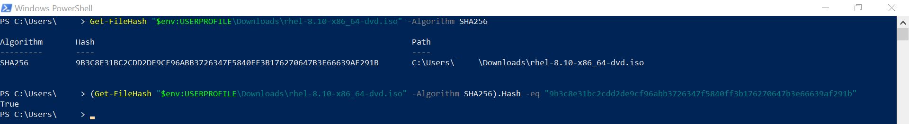

> [!NOTE]
> **Por que conferir?** O checksum garante que o arquivo não corrompeu no download nem foi adulterado. Uma ISO corrompida costuma falhar no meio da instalação, com erros que não apontam para a causa real. Se der `False`, baixe de novo.

### 0.5 Abrir o Hyper-V como administrador

No menu Iniciar, procure **Gerenciador do Hyper-V**, clique com o botão direito e escolha **Executar como administrador**.

O nome do seu computador deve aparecer no painel da esquerda.


> [!TIP]
> Para não precisar elevar toda vez, adicione seu usuário ao grupo **Administradores do Hyper-V** (execute `lusrmgr.msc`, abra Grupos) e saia e entre de novo na sessão do Windows.

---

## Fase 1: Criar a VM

### 1.1 Iniciar o assistente

No painel direito do Gerenciador do Hyper-V, clique em **Novo → Máquina Virtual**.

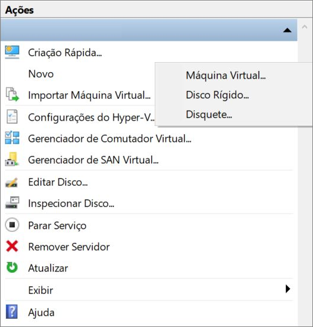

### 1.2 Nome

Use `RHEL8-Lab`.

### 1.3 Geração

Escolha **Geração 2**.

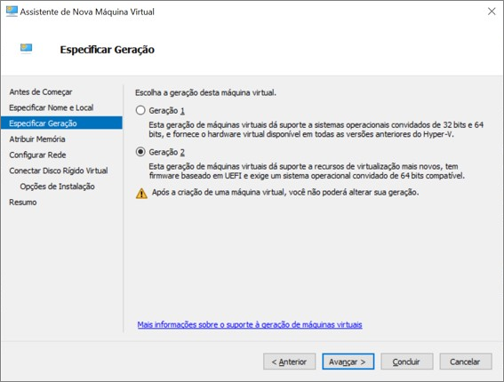

> [!NOTE]
> A Geração 2 usa firmware UEFI, como os servidores atuais. Essa escolha não pode ser alterada depois de criada a VM.

### 1.4 Memória

Informe `4096` MB e **desmarque** "Usar Memória Dinâmica para esta máquina virtual".

### 1.5 Rede

Selecione **Default Switch**.

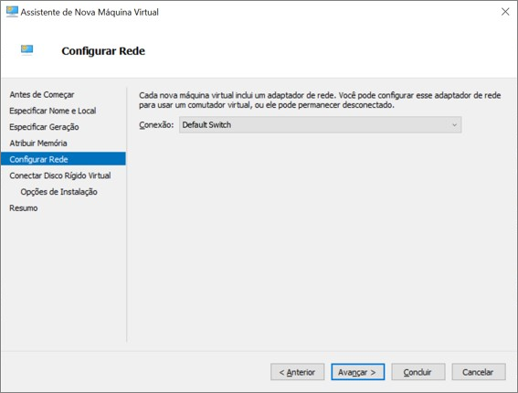

> [!NOTE]
> O Default Switch é uma rede NAT: a VM acessa a internet através do Windows, sem configuração adicional.

### 1.6 Disco

Mantenha "Criar um disco rígido virtual" e defina o tamanho em **40 GB**.

O disco é de expansão dinâmica: o arquivo no Windows só cresce conforme a VM grava dados.

### 1.7 Opções de instalação

Selecione **Instalar um sistema operacional de um arquivo de imagem inicializável** e aponte para:

```
%USERPROFILE%\Downloads\rhel-8.10-x86_64-dvd.iso
```

### 1.8 Resumo

Confira os dados e clique em **Concluir**.

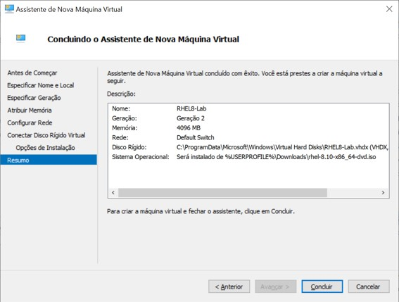

---

## Fase 2: Ajustes antes de ligar

Clique com o botão direito na VM `RHEL8-Lab` e abra **Configurações**.

### 2.1 Inicialização Segura

Em **Segurança**, há dois controles. O que precisa de ação é o segundo:

1. A caixa **Habilitar Inicialização Segura** já vem marcada. Deixe como está.
2. Na lista **Modelo**, logo abaixo, troque `Microsoft Windows` por **Autoridade de Certificação UEFI da Microsoft**.
3. Clique em **Aplicar**.

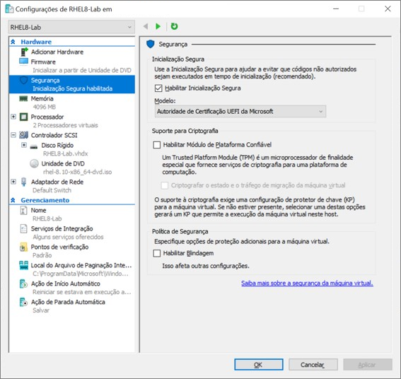

> [!WARNING]
> Este é o erro mais comum. Como a caixa já está marcada, o passo parece feito, mas o modelo padrão (`Microsoft Windows`) só confia no bootloader do Windows. Sem trocar o valor da lista, a VM liga e recusa o instalador do RHEL.

Se a troca não for feita, é esta a tela que aparece ao ligar a VM. A linha que identifica o problema é `The signed image's hash is not allowed (DB)`:

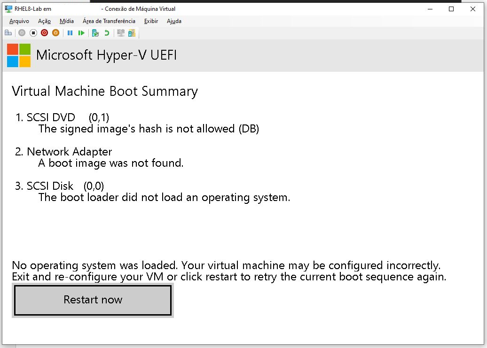

Para conferir, abra o PowerShell **como administrador**:

```powershell
Get-VMFirmware -VMName RHEL8-Lab | Select-Object SecureBoot, SecureBootTemplate
```

O resultado esperado é:

```
SecureBoot SecureBootTemplate
---------- ------------------
        On MicrosoftUEFICertificateAuthority
```

Se aparecer `MicrosoftWindows`, corrija com a VM desligada:

```powershell
Set-VMFirmware -VMName RHEL8-Lab -SecureBootTemplate MicrosoftUEFICertificateAuthority
```

### 2.2 Processador

Em **Processador**, defina `2` processadores virtuais.

### 2.3 Pontos de verificação

Em **Pontos de Verificação**, confirme que a opção está habilitada. Ela será usada no final da Fase 4.

Clique em **OK**.

---

## Fase 3: Instalar o RHEL

### 3.1 Ligar a VM

Clique com o botão direito na VM, escolha **Conectar** e depois **Iniciar**. O menu de boot abre com a opção **Test this media & install** destacada. Use a seta para cima para selecionar **Install Red Hat Enterprise Linux 8.10** e tecle Enter. O teste de mídia é dispensável aqui, porque a integridade da ISO já foi conferida no passo 0.4.

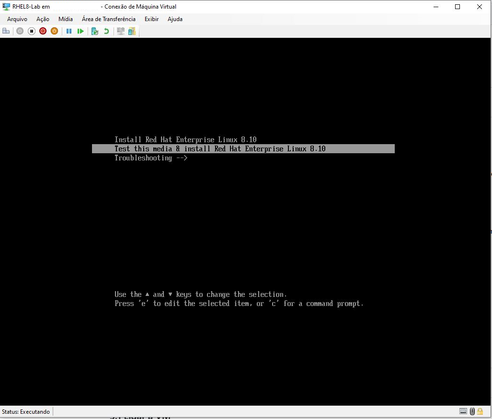

### 3.2 Idioma

Selecione **English (United States)**.

> [!TIP]
> Com o sistema em inglês, as mensagens de erro ficam iguais às da documentação, às dos fóruns etc.

### 3.3 Installation Summary

Esta é a tela central do instalador. Os itens com alerta laranja são obrigatórios e podem ser configurados em qualquer ordem.

Os passos 3.4 a 3.11 percorrem os itens dessa tela, um a um. Ao concluir cada item, o botão **Done** volta para ela.

### 3.4 Keyboard

Adicione **Portuguese (Brazil)** e mova para o topo da lista, se o seu teclado for ABNT2.

### 3.5 Time & Date

Selecione **Americas / Sao Paulo**.

### 3.6 Network & Host Name

1. Ligue a chave da interface de rede (**ON**).
2. Em *Host Name*, informe `rhel8-lab` e clique em **Apply**.

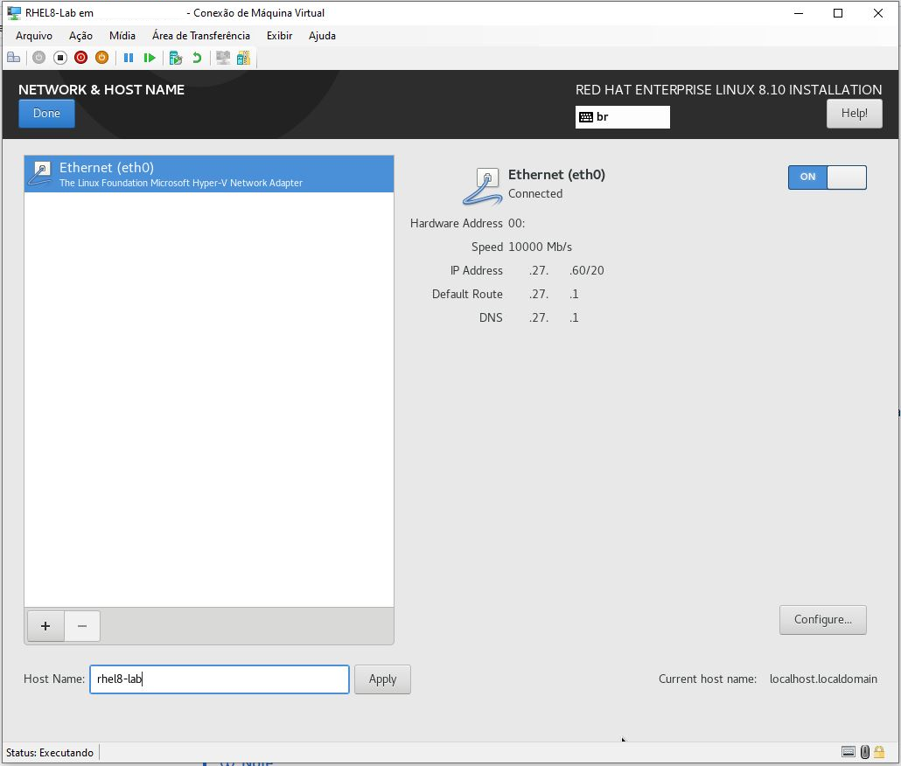

> [!WARNING]
> A rede vem **desligada** por padrão. Quem pula este passo termina a instalação sem internet e precisa configurar a rede manualmente depois.

### 3.7 Installation Destination

Selecione o disco de 40 GB e mantenha **Automatic** em *Storage Configuration*.

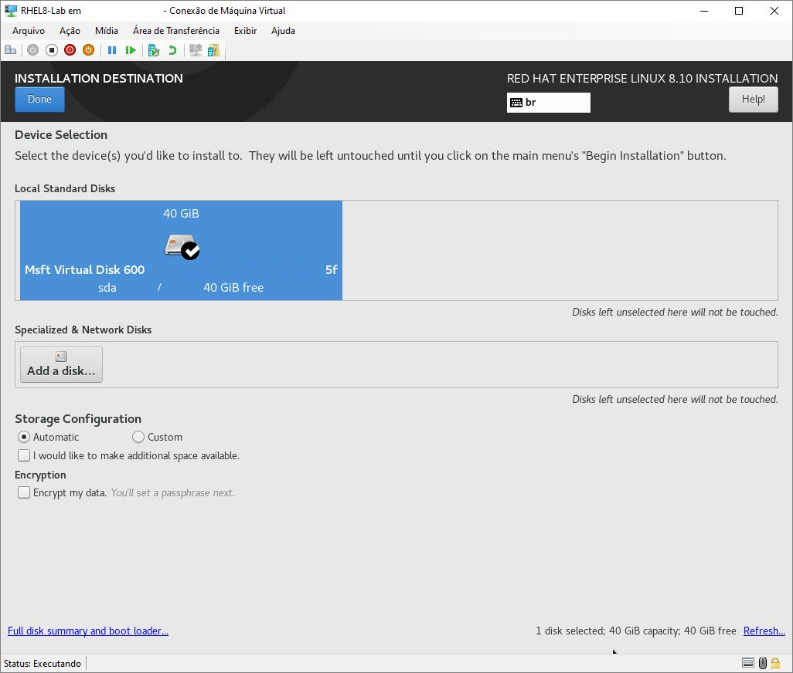

O particionamento automático cria `/boot`, `/boot/efi` e um volume LVM com `/` e swap.

### 3.8 Software Selection

- Em *Base Environment*, selecione **Server**.
- Em *Additional software*, marque **Development Tools**.

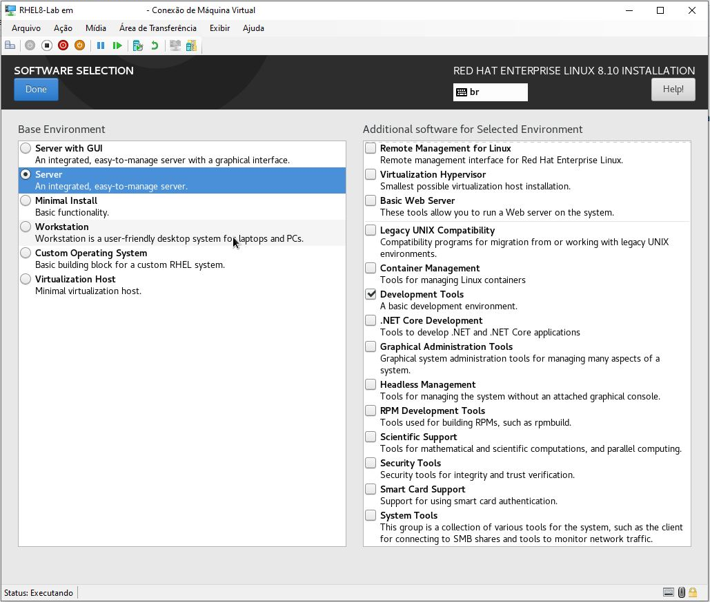

> [!NOTE]
> O grupo *Development Tools* instala `gcc`, `g++`, `make` e `git`, a base para os próximos módulos.

### 3.9 Connect to Red Hat

Não configure agora. O registro será feito pelo terminal na Fase 4.

### 3.10 Root Password

Defina a senha do usuário `root`.

### 3.11 User Creation

Crie o seu usuário e marque **Make this user administrator**.

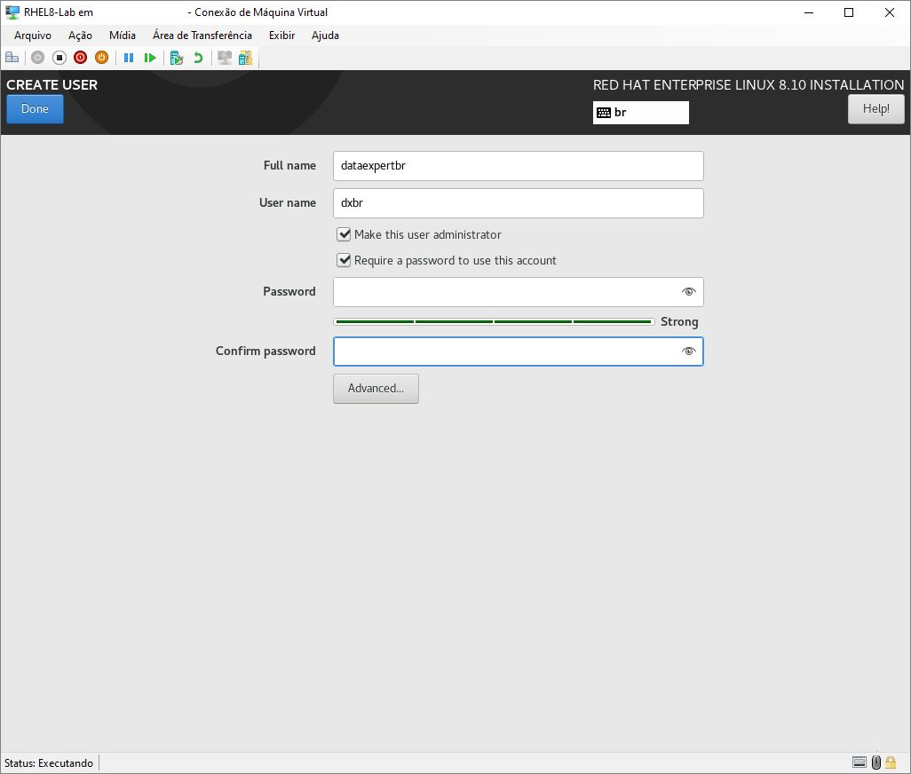

> [!NOTE]
> Essa opção coloca o usuário no grupo `wheel`, que tem permissão de usar o `sudo`. No dia a dia não se trabalha logado como `root`.

### 3.12 Instalar

Clique em **Begin Installation**. A instalação leva de 10 a 20 minutos.

Uma barra de progresso mostra os pacotes sendo instalados. Não é preciso intervir.

Ao terminar, clique em **Reboot System**.

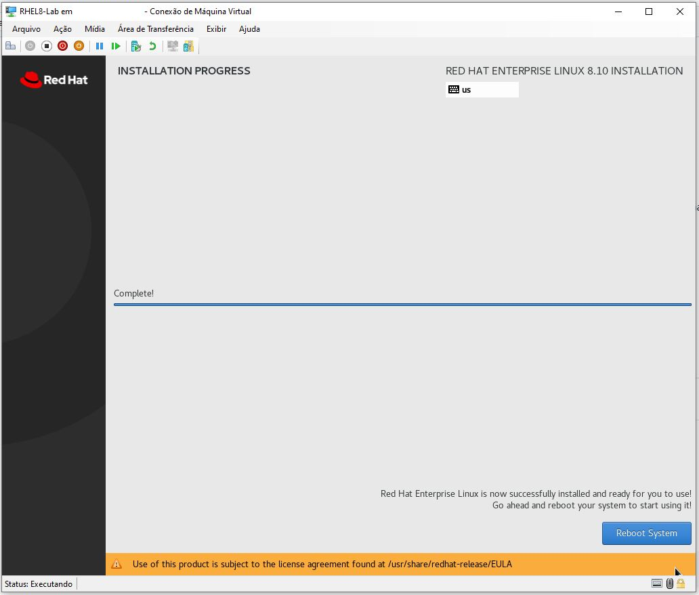

---

## Fase 4: Primeiro boot e registro

### 4.1 Login

Entre com o usuário criado no passo 3.11.

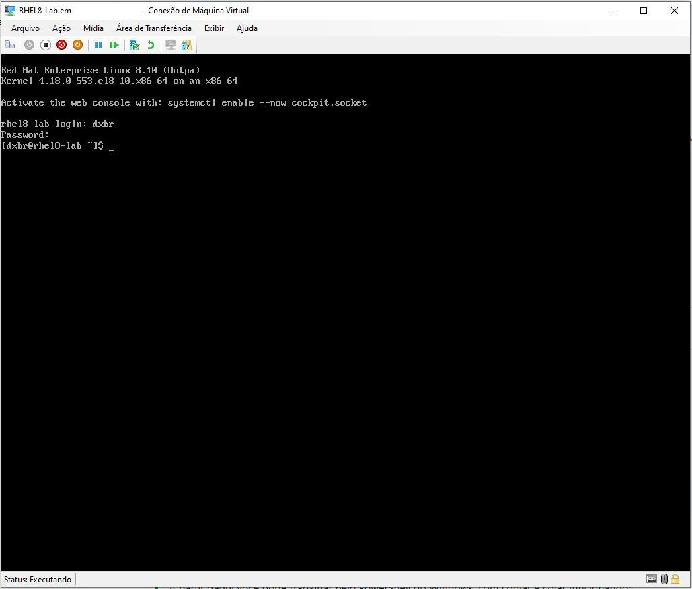

### 4.2 Conferir o sistema

```bash
cat /etc/redhat-release && uname -r && ip -4 addr
```

Anote o endereço IP da interface `eth0`.

> [!TIP]
> A partir daqui você pode trabalhar pelo PowerShell do Windows, com copiar e colar funcionando:
>
> ```powershell
> ssh seu_usuario@IP_DA_VM
> ```

### 4.3 Registrar a subscription

```bash
sudo subscription-manager register
```

Informe o usuário e a senha da sua conta Red Hat (a mesma do passo 0.2).

### 4.4 Listar os repositórios e atualizar

```bash
sudo dnf repolist
```

A saída deve listar os repositórios **BaseOS** e **AppStream**.

```
repo id                              repo name
rhel-8-for-x86_64-appstream-rpms     Red Hat Enterprise Linux 8 for x86_64 - AppStream (RPMs)
rhel-8-for-x86_64-baseos-rpms        Red Hat Enterprise Linux 8 for x86_64 - BaseOS (RPMs)
```

```bash
sudo dnf -y update
```

### 4.5 Criar o ponto de verificação

1. Desligue a VM:

   ```bash
   sudo poweroff
   ```

2. No Gerenciador do Hyper-V, clique com o botão direito na VM e escolha **Ponto de Verificação**.
3. Renomeie o ponto criado para `pos-instalacao-limpa`.

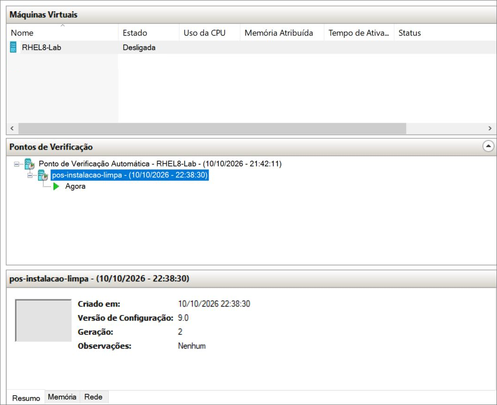

> [!TIP]
> Se o ambiente quebrar durante o curso, clique com o botão direito no ponto de verificação e escolha **Aplicar**. A VM volta a este estado em segundos.

---

## Problemas comuns

| Sintoma | Causa provável | Solução |
|---|---|---|
| "Você não tem a permissão necessária" no Hyper-V | Gerenciador aberto sem privilégio | Passo [0.5](#05-abrir-o-hyper-v-como-administrador) |
| Tela *Virtual Machine Boot Summary* com `The signed image's hash is not allowed (DB)` | Modelo de Inicialização Segura ainda em `Microsoft Windows` | Desligar a VM e refazer o passo [2.1](#21-inicialização-segura) |
| Instalação falha no meio, com erro de pacote | ISO corrompida | Refazer os passos [0.3](#03-baixar-a-iso) e [0.4](#04-conferir-o-checksum) |
| Sem internet após o primeiro boot | Interface de rede desligada no instalador | `sudo nmcli connection up eth0` |
| `dnf` não encontra pacotes | Sistema não registrado | Passo [4.3](#43-registrar-a-subscription) |
| `docker pull registry.redhat.io/rhel8/rhel` retorna 401 | Essa imagem não existe | Ver a nota no início deste módulo |

---

**Próximo módulo:** Módulo 1, Ambiente e fundamentos: GCC, CMake, GoogleTest e o primeiro teste.

*Work hard. Have fun. Make history.*
