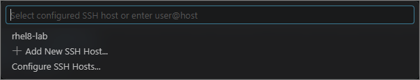
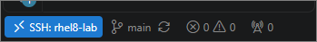
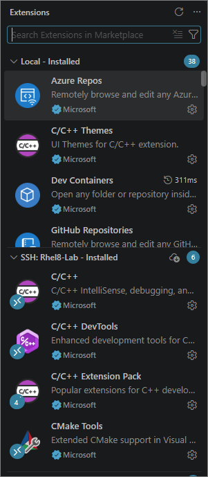
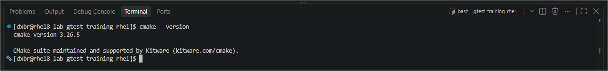
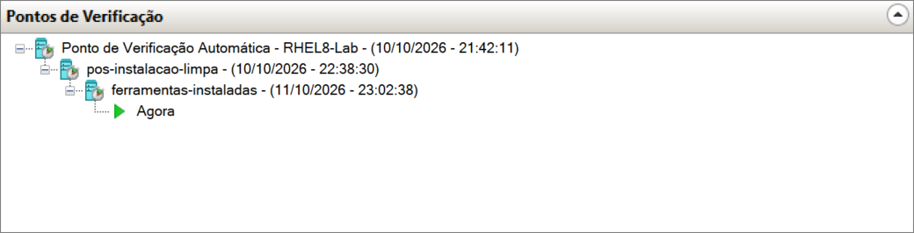

# Módulo 0B: VS Code e ferramentas

Este módulo continua o [Módulo 0A](00a-ambiente-rhel8-hyperv.md). Com a VM pronta, você conecta o VS Code a ela, instala o que falta e confirma que o ambiente compila e executa testes do GoogleTest.

Ao final você terá:

- o VS Code do Windows editando arquivos e abrindo terminais dentro da VM;
- o CMake instalado, ao lado do GCC que já veio com o sistema;
- a confirmação, com um projeto mínimo, de que o ambiente compila e executa testes do GoogleTest;
- um segundo ponto de verificação, com as ferramentas instaladas.

**Tempo estimado:** 40 minutos.

**Pré-requisito:** o Módulo 0A concluído, com a VM `RHEL8-Lab` instalada e registrada.

## Sumário

- [Fase 5: Conectar o VS Code à VM](#fase-5-conectar-o-vs-code-à-vm)
- [Fase 6: Instalar as ferramentas](#fase-6-instalar-as-ferramentas)
- [Fase 7: Validar o ambiente](#fase-7-validar-o-ambiente)
- [Fase 8: Ponto de verificação](#fase-8-ponto-de-verificação)
- [Problemas comuns](#problemas-comuns)

> [!NOTE]
> **Onde cada comando é executado.** Este módulo alterna entre duas máquinas. Os blocos marcados como `powershell` são executados no **Windows**. Os marcados como `bash` são executados na **VM**.

---

## Fase 5: Conectar o VS Code à VM

A VM não tem interface gráfica. Em vez de editar código em um editor de terminal, você usa o VS Code do Windows conectado à VM por SSH: a janela roda no Windows, mas os arquivos, o terminal e o compilador são os da VM.

### 5.1 Instalar o VS Code e a extensão Remote - SSH

No Windows:

1. Instale o VS Code a partir de <https://code.visualstudio.com>.
2. Abra o painel de extensões (**Ctrl+Shift+X**), procure por `Remote - SSH`, da Microsoft, e instale.

Confira também se o cliente SSH do Windows está disponível:

```powershell
ssh -V
```

O resultado deve mostrar uma versão do OpenSSH.

### 5.2 Descobrir o IP da VM

Ligue a VM, entre com o seu usuário pelo console do Hyper-V e execute:

```bash
ip -4 addr show eth0
```

Anote o endereço que aparece depois de `inet`, sem a parte `/20`. Ele será chamado de `IP_DA_VM` nos próximos passos.

> [!NOTE]
> Esse endereço é atribuído pela rede interna do Hyper-V e pode mudar depois que o Windows é reiniciado. Se a conexão parar de funcionar, repita este passo e atualize o endereço no passo 5.5.

### 5.3 Criar uma chave no Windows

```powershell
ssh-keygen -t ed25519 -f "$env:USERPROFILE\.ssh\rhel8_lab" -C "windows-para-rhel8-lab"
```

O comando pergunta por uma senha para a chave. Pode teclar **Enter** duas vezes, deixando sem senha.

São criados dois arquivos na pasta `.ssh` do seu usuário:

| Arquivo | O que é |
|---|---|
| `rhel8_lab` | Chave privada. Fica só no seu computador. |
| `rhel8_lab.pub` | Chave pública. É a que vai para a VM. |

> [!NOTE]
> **Por que uma chave?** Sem ela, o VS Code pede a senha do usuário a cada conexão e a cada reconexão. Com o par de chaves, a VM reconhece o seu computador automaticamente. Deixar sem senha é aceitável aqui porque a chave só dá acesso a uma VM de estudo, que não é alcançável de fora do seu computador.

### 5.4 Enviar a chave pública para a VM

Troque `seu_usuario` e `IP_DA_VM` pelos seus valores:

```powershell
Get-Content "$env:USERPROFILE\.ssh\rhel8_lab.pub" | ssh seu_usuario@IP_DA_VM "mkdir -p ~/.ssh && chmod 700 ~/.ssh && cat >> ~/.ssh/authorized_keys && chmod 600 ~/.ssh/authorized_keys"
```

Na primeira conexão, o SSH pergunta se você confia na VM. Responda `yes`. Em seguida ele pede a senha do seu usuário da VM, pela última vez.

O comando acrescenta a chave pública ao arquivo `~/.ssh/authorized_keys` da VM, que é a lista de chaves autorizadas a entrar. As permissões (`700` na pasta, `600` no arquivo) são exigidas pelo SSH: se outros usuários pudessem alterar essa lista, ele a ignoraria.

### 5.5 Criar o atalho de conexão

No VS Code, tecle **F1**, digite `Remote-SSH: Open SSH Configuration File` e escolha o arquivo `config` que fica na pasta `.ssh` do seu usuário.

Acrescente ao final, trocando os dois valores:

```
Host rhel8-lab
    HostName IP_DA_VM
    User seu_usuario
    IdentityFile ~/.ssh/rhel8_lab
    IdentitiesOnly yes
```

Salve o arquivo. A partir de agora, `rhel8-lab` é um apelido para a VM, já com o endereço, o usuário e a chave.

### 5.6 Testar pelo terminal

```powershell
ssh rhel8-lab
```

Você deve cair direto no terminal da VM, sem digitar senha:

```
[seu_usuario@rhel8-lab ~]$
```

Saia com `exit`.

### 5.7 Conectar o VS Code

1. No VS Code, tecle **F1** e digite `Remote-SSH: Connect to Host`.
2. Escolha **rhel8-lab** na lista.

   

3. Se o VS Code perguntar a plataforma, escolha **Linux**.
4. Uma janela nova abre. Na primeira vez, ela leva um ou dois minutos instalando o componente do VS Code na VM.

Quando terminar, o canto inferior esquerdo da janela mostra **SSH: rhel8-lab**.



Nessa janela, **Terminal → New Terminal** abre um terminal que já está dentro da VM.

### 5.8 Instalar as extensões de C++ na VM

As extensões do VS Code são instaladas por máquina. As que você tem no Windows não valem dentro da VM.

Na janela conectada à VM:

1. Abra o painel de extensões (**Ctrl+Shift+X**).
2. Procure por `C/C++ Extension Pack`, da Microsoft.
3. Clique em **Install in SSH: rhel8-lab**.



O pacote traz as duas extensões usadas no curso:

| Extensão | Para que serve |
|---|---|
| **C/C++** | Realce de sintaxe, navegação pelo código e depuração |
| **CMake Tools** | Configurar, compilar e executar projetos CMake pela interface |

### 5.9 Configurar a análise de código do editor

Enquanto você digita, a extensão C/C++ analisa o código e sublinha os erros. Essa análise (o **IntelliSense**) é independente do compilador: ela não lê o `CMakeLists.txt` e, se ninguém disser como o projeto é compilado, adivinha. No RHEL 8 ela adivinha errado: supõe C++14, o padrão do GCC 8.5, enquanto os projetos do curso usam C++17. O resultado são sublinhados vermelhos em código que compila sem erro.

A solução é mandar o editor usar as opções que o próprio CMake usa. Cada projeto do curso grava essas opções no arquivo `build/compile_commands.json`; falta só apontar o editor para ele.

Na janela conectada à VM:

1. Tecle **F1** e digite `Preferences: Open Remote Settings (JSON)`. Escolha a opção que termina com **(SSH: rhel8-lab)**.
2. O arquivo pode estar vazio (`{}`) ou já ter outras configurações. Acrescente a linha do `compileCommands` dentro das chaves:

   ```json
   {
       "C_Cpp.default.compileCommands": "${workspaceFolder}/build/compile_commands.json"
   }
   ```

   Se já houver outras linhas, separe-as com vírgula.

3. Salve.

`${workspaceFolder}` é a pasta aberta no VS Code. Como a configuração é **remota**, ela vale para qualquer pasta que você abrir na VM, e cada projeto usa o seu próprio `build`.

> [!IMPORTANT]
> **Abra sempre a pasta do projeto**, e não uma pasta acima dela. Se a pasta aberta for, por exemplo, a sua pasta pessoal, o editor procura o arquivo em `/home/seu_usuario/build/compile_commands.json`, não o encontra e volta a adivinhar. O nome no topo do painel **Explorer** mostra qual pasta está aberta.

> [!NOTE]
> O arquivo `compile_commands.json` só existe depois que o projeto é configurado com `cmake -S . -B build`. Até lá, o editor ainda pode mostrar sublinhados. Se continuarem depois da configuração, recarregue a janela com **F1** e `Developer: Reload Window`.

---

## Fase 6: Instalar as ferramentas

Os comandos desta fase são executados na VM. Use o terminal do VS Code conectado.

### 6.1 Conferir o que já existe

O grupo *Development Tools*, escolhido na instalação do sistema, já trouxe o compilador, o Make e o Git:

```bash
g++ --version | head -1; make --version | head -1; git --version
```

Saída esperada (a versão do Git pode ser mais nova):

```
g++ (GCC) 8.5.0 20210514 (Red Hat 8.5.0-29)
GNU Make 4.2.1
git version 2.43.7
```

O curso usa o GCC 8.5, que é o compilador padrão do RHEL 8. Ele oferece suporte ao C++17, o padrão exigido pelo GoogleTest atual.

### 6.2 Instalar o CMake

```bash
sudo dnf -y install cmake
```

Confira:

```bash
cmake --version
```



> [!NOTE]
> **O que é o CMake.** Ele não compila nada sozinho. A partir de um arquivo `CMakeLists.txt`, que descreve o projeto, o CMake gera as instruções para o Make e para o compilador. É o padrão de fato em projetos C++ e é a forma recomendada de usar o GoogleTest.

### 6.3 E o GoogleTest?

Ele **não é instalado no sistema**. Cada projeto declara, no próprio `CMakeLists.txt`, qual versão do GoogleTest usa, e o CMake a baixa e compila junto com o projeto. Esse recurso se chama `FetchContent`.

A vantagem é a reprodutibilidade: todas as pessoas que compilam o projeto obtêm exatamente a mesma versão do framework, sem depender do que está instalado em cada máquina.

Você verá isso funcionando na próxima fase.

---

## Fase 7: Validar o ambiente

Antes de começar o curso, confirme que as peças funcionam juntas: o CMake baixa o GoogleTest, o GCC compila e os testes executam. O projeto abaixo serve só para isso. O significado de cada linha é assunto do Módulo 1; aqui basta copiar, executar e comparar o resultado.

### 7.1 Criar o projeto

No terminal da VM:

```bash
mkdir -p ~/valida-ambiente
```

No VS Code, abra essa pasta em **File → Open Folder**, digitando `/home/seu_usuario/valida-ambiente`. Se ele perguntar se você confia nos autores, responda que sim.

Crie nela o arquivo `CMakeLists.txt`:

```cmake
# Versão mínima de CMake que este projeto exige, e não a instalada.
cmake_minimum_required(VERSION 3.16)
project(valida_ambiente CXX)

set(CMAKE_EXPORT_COMPILE_COMMANDS ON)

set(CMAKE_CXX_STANDARD 17)
set(CMAKE_CXX_STANDARD_REQUIRED ON)
set(CMAKE_CXX_EXTENSIONS OFF)

include(FetchContent)
FetchContent_Declare(
  googletest
  GIT_REPOSITORY https://github.com/google/googletest.git
  GIT_TAG        v1.18.0
  GIT_SHALLOW    TRUE
)
FetchContent_MakeAvailable(googletest)

enable_testing()

add_executable(valida_ambiente valida_ambiente.cpp)
target_link_libraries(valida_ambiente PRIVATE GTest::gtest_main GTest::gmock)

include(GoogleTest)
gtest_discover_tests(valida_ambiente)
```

E o arquivo `valida_ambiente.cpp`:

```cpp
#include <gmock/gmock.h>
#include <gtest/gtest.h>

#include <vector>

TEST(Ambiente, GoogleTestFunciona)
{
    EXPECT_EQ(2 + 2, 4);
}

TEST(Ambiente, GoogleMockFunciona)
{
    const std::vector<int> valores{1, 2, 3};
    EXPECT_THAT(valores, ::testing::ElementsAre(1, 2, 3));
}

TEST(Ambiente, FalhaDeProposito)
{
    EXPECT_EQ(2 + 2, 5);
}
```

### 7.2 Compilar e executar

No terminal do VS Code, entre na pasta do projeto e confirme onde está:

```bash
cd ~/valida-ambiente && pwd
```

O resultado deve ser `/home/seu_usuario/valida-ambiente`. Os comandos a seguir partem dessa pasta: o `.` do primeiro significa "a pasta atual".

Execute os três comandos, um de cada vez:

```bash
cmake -S . -B build
```

```bash
cmake --build build -j2
```

```bash
ctest --test-dir build
```

O primeiro baixa o GoogleTest, por isso a VM precisa de acesso à internet. O segundo compila. O terceiro executa os testes e termina assim:

```
67% tests passed, 1 tests failed out of 3

Total Test time (real) =   0.01 sec

The following tests FAILED:
	  3 - Ambiente.FalhaDeProposito (Failed)
Errors while running CTest
Output from these tests are in: /home/seu_usuario/valida-ambiente/build/Testing/Temporary/LastTest.log
Use "--rerun-failed --output-on-failure" to re-run the failed cases verbosely.
```

**Esse é o resultado esperado:** dois testes passam e um falha. A falha é proposital: um ambiente em que tudo passa não prova que os testes estão sendo verificados de fato. Ver a falha aparecer confirma que estão. As linhas finais, a partir de `Errors while running CTest`, são consequência dessa falha e também são esperadas.

Se o seu resultado tem dois testes passando e o `Ambiente.FalhaDeProposito` como único com falha, o ambiente está pronto para o curso.

---

## Fase 8: Ponto de verificação

1. Feche a janela do VS Code conectada à VM.
2. Desligue a VM. No console dela, ou em um terminal conectado:

   ```bash
   sudo poweroff
   ```

3. No Gerenciador do Hyper-V, clique com o botão direito na VM e escolha **Ponto de Verificação**.
4. Renomeie o ponto criado para `ferramentas-instaladas`.



Agora há dois pontos de retorno: o sistema recém-instalado e o sistema com as ferramentas. Se algo quebrar durante o curso, você volta ao segundo sem refazer este módulo.

---

## Problemas comuns

| Sintoma | Causa provável | Solução |
|---|---|---|
| O VS Code mostra *Could not establish connection* | VM desligada, ou o IP mudou | Ligar a VM, refazer o passo [5.2](#52-descobrir-o-ip-da-vm) e atualizar `HostName` no passo [5.5](#55-criar-o-atalho-de-conexão) |
| `ssh rhel8-lab` pede senha | A chave pública não foi gravada na VM | Refazer o passo [5.4](#54-enviar-a-chave-pública-para-a-vm) |
| Aviso `REMOTE HOST IDENTIFICATION HAS CHANGED` | Outra máquina passou a usar o mesmo IP, ou a VM foi reinstalada | No Windows, `ssh-keygen -R IP_DA_VM` e conectar de novo |
| Realce e navegação de C++ não funcionam na VM | Extensão instalada só no Windows | Passo [5.8](#58-instalar-as-extensões-de-c-na-vm) |
| O projeto compila, mas o editor sublinha `ASSERT_EQ` e `EXPECT_EQ` com *expression must have bool type* | O editor está analisando o código em C++14, sem as opções do CMake. Causas comuns: a configuração do passo 5.9 não foi feita, o projeto ainda não foi configurado, ou a pasta aberta no VS Code não é a do projeto | Conferir o passo [5.9](#59-configurar-a-análise-de-código-do-editor) e a pasta mostrada no topo do **Explorer**; depois, `cmake -S . -B build` e **Developer: Reload Window** |
| `cmake: command not found` | CMake não instalado | Passo [6.2](#62-instalar-o-cmake) |
| O primeiro comando do passo [7.2](#72-compilar-e-executar) falha ao baixar o GoogleTest | VM sem acesso à internet | Testar com `curl -I https://github.com` na VM |
| Erro de compilação mencionando C++17 | Faltam as linhas `CMAKE_CXX_STANDARD` | Conferir o `CMakeLists.txt` do passo [7.1](#71-criar-o-projeto) |

---

**Próximo módulo:** Módulo 1, Fundamentos: o primeiro projeto de testes, `TEST`, `EXPECT_*` e `ASSERT_*`.

*Work hard. Have fun. Make history.*
